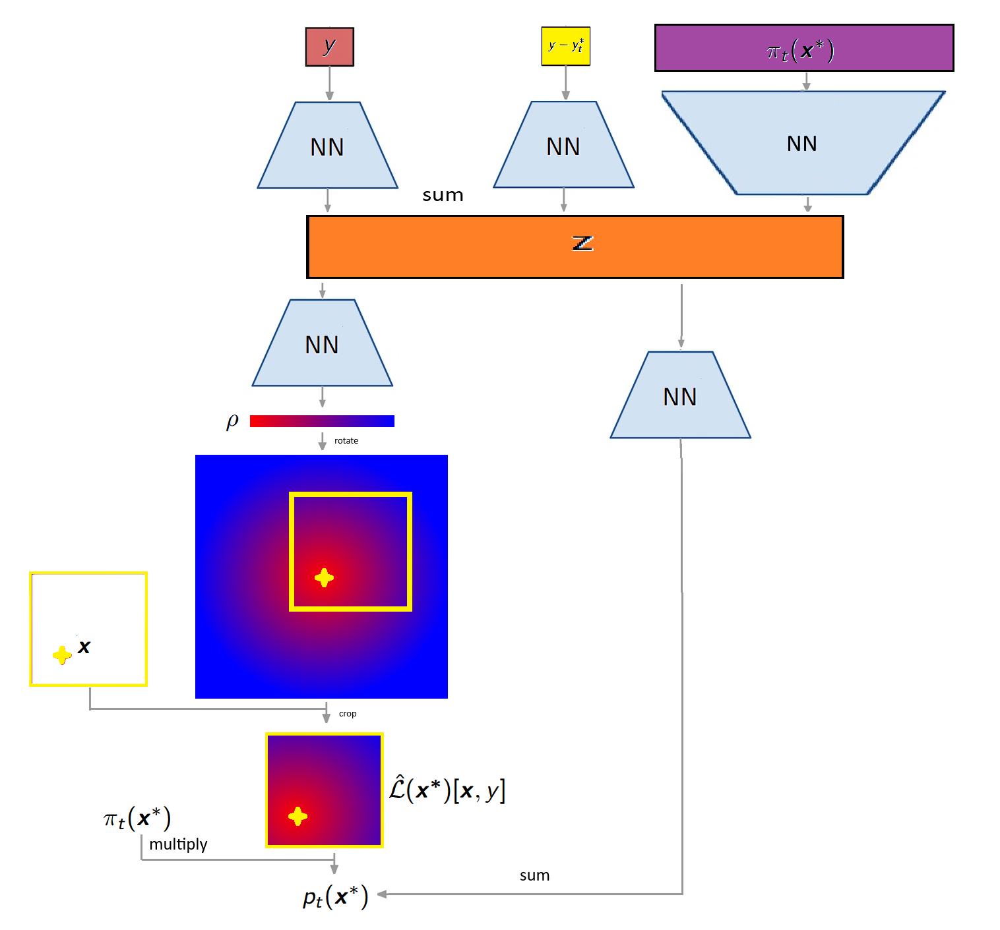

# LeonArDBO

Code for the paper **"LeonArDBO: Fast and Prior-Driven Bayesian Optimization without Surrogate Modeling"** ([OpenReview](https://openreview.net/forum?id=lSuYUCtIcj)).

LeonArDBO skips the surrogate model. A neural network learns to update a belief over the optimizer's location, $`\pi_t(\mathbf{x}^*)`$, directly. At each step the network takes the new observation $`y`$, the gap to the incumbent $`y - y_t^*`$, and the current belief $`\pi_t(\mathbf{x}^*)`$. It outputs a learned likelihood $`\hat{\mathcal{L}}(\mathbf{x}^*)[\mathbf{x}, y]`$, which is multiplied with the prior to give the updated belief $`p_t(\mathbf{x}^*)`$.

<p align="center"></p>

## Repository structure

```
method/
  generate_data.py   # roll out BO on GP samples to build (prior, posterior, x, y) training data
  train.py           # train convNetLeonArDBO on 1D / 2D / 3D grids
  models.py          # network definitions (y encoder, prior conv encoder, convNetLeonArDBO)
  utils.py           # dataset class and helpers
  gp_model.py        # GPyTorch / BoTorch GP used to generate data
  image.png          # architecture figure
mismatch_in_the_wild/
  corners.py         # prior-mismatch analysis on real-world benchmark datasets (e.g. AgNP)
```

## Usage

1. **Generate training data.** Set `dim`, `grid_size`, `N`, `T`, `M`, and `policy` at the top of `method/generate_data.py`, then run:
   ```bash
   cd method
   python generate_data.py
   ```
   This writes `priors_*.pt`, `posteriors_*.pt`, `new_xs_*.pt`, `new_ys_*.pt`, and `regrets_*.pt`.

2. **Train.**
   ```bash
   python train.py --dim 2
   python train.py --dim 3 --epochs 2000 --loss kl
   ```
   Run `python train.py --help` to see all options (loss: `kl` / `cse` / `hel`, LR schedule, Comet logging, and more).

## Dependencies

`torch`, `gpytorch`, `botorch`, `numpy`, `pandas`, `scikit-learn`, `matplotlib`, and optionally `comet_ml`.

4D grids also need an external `conv4d` module that provides `Conv4d` and `BatchNorm4d`. It is not included here, and 1D–3D runs don't need it.

`mismatch_in_the_wild/corners.py` imports `gp_model` from `method/`, so put `method/` on your `PYTHONPATH` before running it.

## Citation

If you use this code, please cite the paper (see the [OpenReview page](https://openreview.net/forum?id=lSuYUCtIcj) for the BibTeX).
